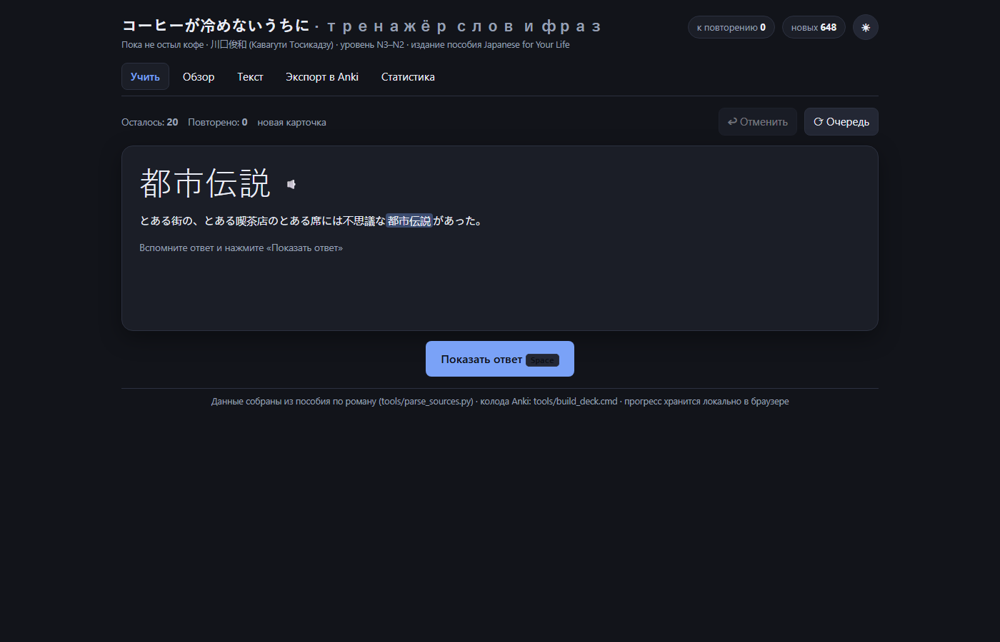
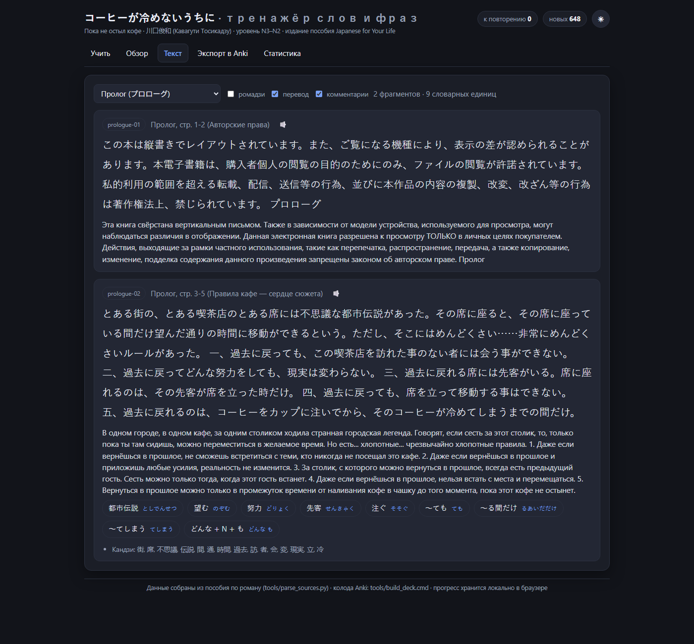

# コーヒーが冷めないうちに — тренажёр слов и фраз + колода Anki

Приложение для проекта **Japanese for Your Life**: учит лексику и фразы романа
川口俊和 «コーヒーが冷めないうちに» («Пока не остыл кофе») и собирает из них готовую колоду Anki.

Материал: пролог и четыре главы — 118 разобранных фрагментов текста и 207 словарных единиц
(слова, грамматические конструкции, звукоподражания) с чтением каной, переводом на русский,
уровнем JLPT и живым контекстом из романа.

Готовая колода: **325 заметок** (207 «Kohi Novel Card» + 118 «Kohi Novel Phrase») и
**648 карточек**: распознавание 207, воспроизведение 207, слово в контексте 116, фразы 118.
Те же числа показывает вкладка «Экспорт в Anki» — приложение и скрипт колоды используют
один и тот же алгоритм поиска слова в предложении.

## Что умеет

| Экран | Возможности |
|---|---|
| **Учить** | Сессия интервальных повторений: 5 типов карточек, оценка 1–4, отмена, озвучка японского через синтез речи браузера (ja-JP) |
| **Обзор** | Поиск и фильтры (глава, тип, уровень JLPT), карточка слова с контекстом, отметка слов для выборочной колоды |
| **Текст** | Фрагменты романа: оригинал, ромадзи, перевод, комментарии, чипы лексики с озвучкой |
| **Экспорт в Anki** | TSV и CSV с файловыми заголовками Anki, JSON для сборки `.apkg`, предпросмотр файла, инструкция по импорту |
| **Статистика** | Изучено / к повторению / новых, удержание, серия дней, график за неделю, прогресс по главам, настройки занятий |

Типы карточек: «японский → значение», «значение → японский», «слово в контексте» (с пропуском),
«аудирование», «фразы из романа» (118 предложений с переводом). Прогресс хранится локально
в браузере (`localStorage`), ничего никуда не отправляется.





## Быстрый старт

```bash
pnpm install          # или npm install
pnpm dev              # http://localhost:5173
pnpm build            # сборка в dist/
```

Node 20+ (проверено на Node 24). Внешних сервисов и ключей не требуется.

## Как получить колоду в Anki

**Способ 1 — готовая колода `.apkg` (рекомендуется).**
Запустите `tools\build_deck.cmd` (двойной щелчок). Скрипт использует Python из установленного
Anki и создаёт файл `anki\kohi_コーヒーが冷めないうちに.apkg` с типами заметок и шаблонами карточек.
Откройте его двойным щелчком — Anki импортирует колоду с подколодами по главам:

```
コーヒーが冷めないうちに
├── 00 プロローグ  ├── Слова ├── Грамматика ├── Фразы
├── 01 恋人        …
├── 02 夫婦
├── 03 姉妹
└── 04 親子
```

**Способ 2 — выгрузка из приложения.**
Вкладка «Экспорт в Anki» → выберите объём (всё, главы, отмеченные слова, трудные карточки) →
`⬇ Anki: карточки (TSV)` → в Anki: Файл → Импорт. В файле есть заголовки `#separator:tab`,
`#html:true`, `#notetype column`, `#deck column`, `#tags column`, поэтому Anki создаст тип заметки
и колоду сама (Anki 2.1.60+). Вариант без колонок Notetype/Deck — для ручного сопоставления полей.

Поля типа заметки «Kohi Novel Card»:
`Term, Reading, Meaning, Example, ExampleMasked, Translation, Romaji, Chapter, Level, Kind, Note, Source`.

## Структура проекта

```
kohi-anki/
├── src/                       # React + TypeScript приложение
│   ├── components/            # экраны: StudyView, BrowseView, ReaderView, ExportView, StatsView, CardView
│   ├── lib/
│   │   ├── dataset.ts         # индексация данных, генерация карточек, поиск слова в предложении
│   │   ├── srs.ts             # планировщик повторений (SM-2 с шагом обучения)
│   │   ├── tts.ts             # озвучка через Web Speech API (ja-JP)
│   │   ├── ankiExport.ts      # сборка TSV/CSV/JSON для Anki
│   │   └── storage.ts         # прогресс и настройки в localStorage
│   └── data/novel.json        # собранная база романа (генерируется)
├── tools/
│   ├── parse_sources.py       # Markdown-пособие → src/data/novel.json
│   ├── build_deck.py / .cmd   # сборка .apkg для Anki
│   ├── verify_deck.py         # проверка .apkg на временной коллекции Anki
│   ├── test_logic.ts          # юнит-проверки планировщика (node tools/test_logic.ts)
│   └── serve_dist.mjs         # локальная раздача dist/ для проверки
├── data/readings.json         # чтения каной для слов, где в пособии было только романдзи
├── anki/
│   ├── kohi_コーヒーが冷めないうちに.apkg   # готовая колода
│   └── _build/kohi_build.anki2            # рабочая коллекция сборки (не удалять!)
└── ...
```

> `anki/_build/kohi_build.anki2` — служебная коллекция: в ней типы заметок создаются один раз,
> поэтому их id стабильны между сборками и повторный импорт колоды обновляет заметки, а не
> плодит дубликаты вида «Kohi Novel Card+». Файл нужно сохранять вместе с проектом.

## Обновление базы

```bash
python tools/parse_sources.py     # пересобрать src/data/novel.json из Markdown-пособия
```

Пути к источникам заданы в `tools/sources.json` (пособие по роману и файл глав 2–4 из
`Japanese_for_my_Life`). Скрипт печатает отчёт в `tools/report_parse.txt`: сколько фрагментов,
единиц, какие замечания. Чтения каной можно поправить в `data/readings.json` — они имеют
приоритет над источником.

## Технические детали

* **Планировщик**: упрощённый SM-2. Новая карточка → шаг обучения 10 минут, далее интервалы
  1 день → ×ease (2.5, границы 1.3–2.9, максимум 365 дней). «Снова» уменьшает ease и возвращает
  карточку через минуту, «Трудно» — ×1.2, «Легко» — ×1.35 с ростом ease.
* **Карточки**: `recog`, `prod`, `context` (слово заменено на ［　］), `listen`, `phrase`.
  Идентификатор карточки — `<слово>::<тип>`, фразы — `frag:<id>::phrase`.
* **Проверки**: `node tools/test_logic.ts` (17 проверок планировщика), `npx tsc --noEmit`,
  `tools\verify_deck.cmd` (35 проверок собранной колоды на временных коллекциях Anki: состав
  заметок и карточек, шаблоны, GUID, идемпотентность повторного импорта).
